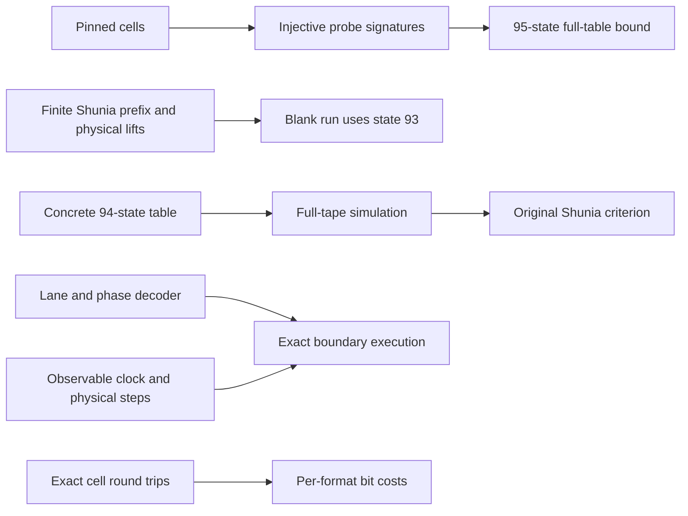

# HS-95 lane 02

Local source attribution is grwtsk contributors. Formalization and checking assistance by OpenAI Codex.

## A. Turing control states

For every natural n, binary write–move table D on Fin n, and map f from Fin 95 to Fin n, suppose D(f(q),b) equals the source cell with its successor mapped by f for every state q and read symbol b. This preserves halts, write bits and moves. Then n ≥ 95. Induction on a supplied read word shows that f preserves its write–move trace. The probe words 00110000, 10010000, 1110, 1011000, and 01011000 give 95 distinct trace signatures. Thus f is injective. A separate finite refinement of the full symbolic read tree yields 13, 34, 57, 77, 85, 92, 94, and 95 classes at depths one through eight. The consumer is a proposed full-table one-step control quotient. [states_le_of_exactQuotient](Riemann95ControlCompression.lean)

The explicit deletion candidate drops state 93, redirects its sole incoming edge to state 0, and renumbers old state 94. Its blank-start halting theorem requires every reachable configuration to avoid 93. The unique incoming cell is state 91 reading 1. Simulations of the first ten million elementary steps missed it. The pinned stage and parser proofs locate it on the blank run.

1. Every arithmetic argument from 2 to 125 passes the stopping test. The original Shunia deficit and threshold are (1,32) at 36 and (2,80) at 125. The local integer certificates are `earlyStages_pass` and `stageDeficits`. The deficit uses the offset digit count in base n of n! times the primorial of n, minus one. [Integer definitions](https://github.com/google-deepmind/cryptids/blob/3647718b5df22e1a61462dec0376bd204526285a/Cryptids/Riemann120.lean#L1552)
2. The bootstrap reaches the stage-zero root. Induction with the passing branch of `physical_stage_outcomes` reaches roots for M = 34 and 123. Prewidth and precredit yield entry registers [0,0,Δ,M+1,M+1], with Δ the deficit at M+2. The entry step and two bounded halvings reach the third halving with Δ unchanged. A common bound of 19 suffices for the depth-zero prefix, and the stage padding invariant supplies at least 21. The positive branches take local label 15 at argument 36 and local label 16 at argument 125. [Bootstrap](https://github.com/google-deepmind/cryptids/blob/3647718b5df22e1a61462dec0376bd204526285a/Cryptids/ReductionSupport/Riemann95/Bootstrap95.lean) · [Stage step](https://github.com/google-deepmind/cryptids/blob/3647718b5df22e1a61462dec0376bd204526285a/Cryptids/ReductionSupport/Riemann95/Stage95.lean#L26) · [Prewidth](https://github.com/google-deepmind/cryptids/blob/3647718b5df22e1a61462dec0376bd204526285a/Cryptids/ReductionSupport/Riemann95/TypedPrewidth95.lean#L237) · [Precredit](https://github.com/google-deepmind/cryptids/blob/3647718b5df22e1a61462dec0376bd204526285a/Cryptids/ReductionSupport/Riemann95/PrecreditTrace95.lean#L98) · [Bounded first and second halves](https://github.com/google-deepmind/cryptids/blob/3647718b5df22e1a61462dec0376bd204526285a/Cryptids/ReductionSupport/Riemann95/Bounded95.lean#L122) · [Halving](https://github.com/google-deepmind/cryptids/blob/3647718b5df22e1a61462dec0376bd204526285a/Cryptids/ReductionSupport/Riemann95/WidthSteps95.lean)
3. The bounded trace lift gives the physical prefixes. The parser enters state 46 after the caller prefix. Suffixes 15 and 16 begin with 111001, giving the path 46, 60, 76, 83, 88, 91, 93. Suffix 16 scans 1 when it reaches 93. These local tape observations are checked in Lean. Their composition with the upstream stage lemmas is an analytic argument. It falsifies deleting 93 as unreachable and the proposed fold of 93 into 91 using row 91 as an exact blank-run step simulation. [Trace lift](https://github.com/google-deepmind/cryptids/blob/3647718b5df22e1a61462dec0376bd204526285a/Cryptids/ReductionSupport/Riemann95/PhysicalTrace95.lean#L127) · [Parser schema](https://github.com/google-deepmind/cryptids/blob/3647718b5df22e1a61462dec0376bd204526285a/Cryptids/ReductionSupport/Riemann95/ControllerSchema95.lean) · [Parser tape semantics](https://github.com/google-deepmind/cryptids/blob/3647718b5df22e1a61462dec0376bd204526285a/Cryptids/ReductionSupport/Riemann95/Parser95.lean#L87)

`halts_iff_of_macro_simulation` requires related blank starts, a positive target run for every step from a related reachable source configuration, and terminal agreement. `halts_iff_of_checkpoint` allows the replacement to relate its own blank start to an initialized source checkpoint reached by the source's bootstrap. Alternative register orders must supply a relation on the actual tape. The published five-register permutation supplies a logical step identity. Bare classical existence of an equivalent one-state machine follows by choosing the halter or looper after a split on the desired truth value. A constructive 94-state result needs a concrete table and a full-source preservation proof. [Register permutation](https://github.com/google-deepmind/cryptids/blob/3647718b5df22e1a61462dec0376bd204526285a/Cryptids/ReductionSupport/Riemann95/ReferencePermutation95.lean)

## B. Prime lanes

For all naturals n, L, P, an encoder from Fin n to Fin L × Fin P with a partial decoder returning each encoded state exists iff n ≤ LP. A decoder forces injectivity. Equivalently each lane can contain at most P distinct controls. Row-major packing attains the bound. Tick fP+p recovers phase p modulo P and advances between adjacent frames for arbitrary phase choices. The 95×1, 5×19, and 1×95 layouts use canonical prime lane labels. [PrimeLaneMultiplexing.lean](../../../NumberTheory/PrimeLaneMultiplexing.lean)

Erasing phase collides states 0 and 1 in the 5×19 layout. Erasing lane collides 0 and 19. On read 0 their respective successor pairs (48,1) and (48,77) differ in the coordinate that was equal on input. The complete pair and full tape give exact boundary transition and terminal transport via `layout_eval` and `onePrimeLane_halts_iff`. An implementation must expose the phase and execute the decoded source step at each boundary. Existing exact-recovery and sofic interfaces apply when the implementation preserves that information. [Ordered addresses](../../../NumberTheory/OrderedPrimeGroupAddress.lean) · [Heat compression](../../../NumberTheory/HeatFlowCompressionSofic.lean) · [Finite heat bridge](../../../NumberTheory/FiniteHeatCompressionBridge.lean) · [Moment collision boundary](../../../NumberTheory/ZetaAndLFunctionsAnalyticTheory/BombieriDynamicSoficCoverBoundary.lean)

## C. Description bits

For n controls the action alphabet has a halt token and 4n write, move and target triples, giving (1+4n)^(2n) tables. The smallest common fixed width for all 95-state tables is 1,629 bits by the exact comparison of 381^190 to the adjacent powers of two. Fixed nine-bit cells cost 1,710 bits. First-window prime targets need nine bits since the last prime is 499. Adding two action bits and reserving one word for halt gives 2,090 bits. Separate 5×19 fields cost 3+5 target bits and two action bits. Mixed-radix packing recovers nine total bits per action. The numeral 95 has bit length seven. [TransitionTableDescription.lean](TransitionTableDescription.lean)

The generated window uses the rank table and charges seed, generator, decoder and proof bits. Let G be the total extra overhead for the generated format and R the corresponding raw-format overhead. Generation beats raw prime-tag cells iff G < R+380. With an explicit 855-bit prime schedule charged to the raw format, the condition is G < R+1235. All-halt and all-move tables share exactly the same prime schedule, while the rank and prime tag round trips recover the transition data. The shortest program for this particular table under a chosen universal description language is unestimated.

## Proof obligations and provenance

`GRWTSK.ComputerScience.Riemann95ControlCompression` translates all 190 cells from Google DeepMind Cryptids revision `3647718b5df22e1a61462dec0376bd204526285a`, Git blob `d6f841a883bcf826d1fbdbd1c66497e072231c55`, SHA-256 `7e9731ed1b7c63d4e67c0f8d646f8498d9645f26e237a8604d4b7f91a6ab398d`. A token comparison from the Lean array back to the export matched every cell in order. The local model uses Mathlib's full tape with the source cell update and blank convention. The formal handoff between the local and upstream tape types and cross-toolchain replay of the stage-to-parser proof on 4.35.0-rc4 remain `NOT_RUN`. The upstream names returning to arithmetic are `ConjectureMachines.Riemann95.halts_candidate_iff_counterexample` and `ConjectureMachines.Riemann95.Semantics.halts_candidate_iff_not_riemannHypothesis`. The translated data and recurrences retain Google LLC copyright and Apache-2.0 terms. [Export](https://github.com/google-deepmind/cryptids/blob/3647718b5df22e1a61462dec0376bd204526285a/artifacts/riemann_95/machine.txt) · [Loader](https://github.com/google-deepmind/cryptids/blob/3647718b5df22e1a61462dec0376bd204526285a/Cryptids/Machines.lean) · [Arithmetic theorem](https://github.com/google-deepmind/cryptids/blob/3647718b5df22e1a61462dec0376bd204526285a/Cryptids/Riemann95.lean) · [RH theorem](https://github.com/google-deepmind/cryptids/blob/3647718b5df22e1a61462dec0376bd204526285a/Cryptids/Semantics/Riemann95.lean) · [License copy](../../../../LICENSES/upstream/cryptids/Apache-2.0.txt)

All three local modules compiled on Lean 4.34.1 and Mathlib `d13f23b723b8a846827a245b89c10fc7d3f11612`. The finite witnesses use kernel-checked decisions. Transitive axiom audits found only `propext`, `Classical.choice`, and `Quot.sound`. Fresh kernel replay, including imported declarations, passed for all three modules. Independent scholarly review is `NOT_RUN`.

Verified local source SHA-256 values

- `Riemann95ControlCompression.lean` has SHA-256 `003df9302b9c23288c47147d614ea4816a9c1f73d26f117fdf71bc273601cfd6`.
- `PrimeLaneMultiplexing.lean` has SHA-256 `4b46536c6f82f6377c7efd0972b3033c0b93902c94e4f80e830c07218dad41ba`.
- `TransitionTableDescription.lean` has SHA-256 `44759cd93f948224a6f7ae655cdcc8ec5af41692ae447f569082801c1276baa0`.
