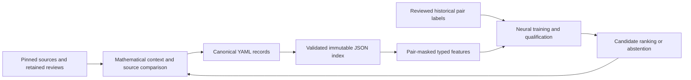

# Mathematics-wide ontology for neural-assisted discovery

Local attribution: grwtsk contributors.

This corpus is the mathematical memory for source-bound search, proof planning and Noeaaeue's neural candidate ranking. Individually addressable YAML records preserve the objects, statements, arguments, examples, counterexamples and comparisons that make a retrieved connection useful. A learner can prioritize a candidate; a reader must still be able to recover its exact context, joint premises, source and remaining work.

The scope is mathematics-wide, from elementary learning through the pinned MSC2020 subject scaffold. The [spectral geometry of the prime-coded reflective kernel](views/grwtsk.spectral-kernel.yaml) remains an important organizing view. It places no restriction on which mathematics belongs here.

| Start with your task | Entry point |
|---|---|
| Find a mathematical object or statement | [Subjects](subjects/), [entities](entities/) and [independent entry points](views/independent-entry-points.yaml) |
| Prepare useful neural inputs and reviewed examples | [Learning contract and contribution priorities](LEARNING.md) |
| Recover the actual source or an unresolved obligation | [Source and issue mappings](mappings/), [Weil certificate routes](views/grwtsk.weil-certificate-routes.yaml) |
| Validate, export, inspect features or rank explicit candidates | [Pinned companion tooling](https://github.com/grwtsk/noeaaeue/tree/26991b68bc6458b10c4d0b279fc2c5cb2092811f/tools/ontology) |

## Build a learnable mathematical corpus

The contribution unit is a source-bound mathematical move: what a result consumes, what it supplies, why the argument works, and which comparison returns it to the intended problem. Preserve all premises of one rule together and retain alternative rules separately. Definitions, theorem applications, counterexamples, source observations and analogies have different roles even when they share words or endpoints.

The data path has distinct review boundaries:

Retained review events also have their own validated compact projection for source inspection and blocker/supplier queries. That projection preserves complete syntax bindings and evidence; it does not automatically create canonical mathematical entities, supervised labels or proof-eligible facts. The [learning contract](LEARNING.md) explains the source-context boundary and the separate validation needed before a Rust consumer reads an export.

### Current neural consumer

The companion revision in the manifest implements neural v8: 76 source-masked inputs, 72 learned nonnegative channel gates, two dense ReLU layers (`76 → 16 → 8`) and a sigmoid ranking readout. Its graph aggregates are fixed by the source snapshot. Training changes gates and dense weights; it does not discover or certify new mathematical edges. The logistic, lexical and structural rankers remain comparison baselines. See the pinned [model contract](https://github.com/grwtsk/noeaaeue/blob/26991b68bc6458b10c4d0b279fc2c5cb2092811f/src/ontology_neural.rs) and [feature encoder](https://github.com/grwtsk/noeaaeue/blob/26991b68bc6458b10c4d0b279fc2c5cb2092811f/src/ontology_neural_graph.rs).

| Corpus content | Current neural use | What a contributor should preserve |
|---|---|---|
| Top-level entity text, subjects, kind and context | Lexical overlap, subject overlap, role and context features | Precise statements, stable IDs, genuine subject associations and reviewed contexts |
| Documented/established typed relations | Directed neighborhood aggregates with selected named relation channels | Direction, actual relation meaning, source and justification |
| Established ground inference rules | Joint-premise factors, including side conditions and arity | Complete AND inputs, conclusion, context and concrete instantiation |
| Full bindings, hypotheses, counterchecks, evidence, costs and blocker details | Retained for review and other consumers; their full semantics are outside the 76-channel encoder | Exact source bytes and scope rather than compressing them into a favorable label |

Proof-mode ranking requires equal known contexts. V8 also abstains on unseen exact ordered context pairs or numerical features outside its training support. A shared subject, an in-range feature vector, or a high rank does not establish applicability. Read the [context and dataset-readiness contract](LEARNING.md#source-identity-and-mathematical-context) before constructing a cohort.

Useful expansion therefore needs both breadth and depth: rotate across subjects, then curate coherent families of definitions, statements, actual applications and hostile boundary examples within reviewed mathematical contexts. More classification nodes, repeated wrappers or source-review counts do not by themselves supply training diversity. Real historical labels, complete held-out coverage and measured improvement over the baselines remain separate work. No production weights or independently established real-corpus discovery gain are supplied by this release.

## Release and coverage

[manifest.yaml](manifest.yaml) identifies the release and its evidence and search policies. [records.schema.json](schemas/records.schema.json) describes the record profile. All of the following denominators are finite, pinned inventories.

Manifest policies describe corpus curation and publication. They are not scheduler settings, training parameters or new runtime gates; the pinned companion implements its own versioned consumer contract.

| Inventory | Coverage | Interpretation |
|---|---:|---|
| Curated semantic layer | 110 entities, 45 relations, 14 inferences | A starting graph with 11 contexts; two inference records are established ground rules |
| MSC2020 identifiers | 6,603 / 6,603 | 63 roots, 534 groups and 6,006 details in the two pinned official downloads |
| MSC2020 root source plans | 63 / 63 | One authored plan per root plus a separate elementary plan |
| GRWTSK Git tree dispositions | 151,988 / 151,988 | 150,308 pending semantic or source review and 1,680 justified exemptions |
| GitHub issue dispositions | 1,156 / 1,156 | 1,085 open and 71 closed at capture. 13 have local architecture mappings, 1,127 are pending and 16 are exempt |
| Legacy v1 IDs | 89 / 89 | Native targets or immutable v1 locators. The crosswalk also resolves unkeyed legacy relations |

The subject counts use the publisher's downloads as the denominator. The publisher's landing page lists different group and detail totals. The [classification inventory](corpora/msc2020.yaml) records both sets of counts and the exact file pins. Its [notice](subjects/MSC2020-NOTICE.md) scopes the publisher's CC BY-NC-SA 4.0 terms to the classification projection.

The [repository inventory](corpora/math.yaml) is pinned to GRWTSK revision `2b232aa5aaa6c80fe13a87a94c1b5ce81ddaa011`. It includes the root and 75,190 Lean files under `GRWTSK/`, authored and verification documentation, adapters and operational files. The root umbrella has 451 import lines. Import inventory, mathematical entity extraction and proof dependency extraction describe separate work. The [v1 migration](migrations/grwtsk.v1.yaml) retains historical paths, attachment digests and distinctions between proof candidates and their mathematical targets.

The source plans seed open-ended construction. Each plan gives topics, scoped acquisition leads and an initial task. A classification code, a semantic entity, and a source unit each have their own progress measure. The release measures recorded source correspondence, mathematical disposition and formal evidence separately from inventory coverage. It contains no estimate of the percentage of mathematics represented.

The table describes the canonical pinned inventories, including their historical `pending` dispositions. Live lexical inspection, retained semantic reviews, neural training labels and model qualification have separate ledgers in Noeaaeue. Completing one does not rewrite the others. The canonical semantic export contains 262 records; full metadata validation covers 345 records, including corpus and mapping shards. These counts are record populations, not theorem or training-example counts.

## Records and identity

- `subjects/` contains classification and learning entry points. An entity can belong to several subjects.
- `contexts/` names foundations, assumptions and conventions. The examples distinguish classical point-set topology, constructive rational representations and Lean dependent type theory. A context transport requires its own scoped comparison.
- `entities/` separates concepts from definition variants, mathematical statements, proofs, examples and implementations. `subjects` and `context` are explicit references. `statement` records the mathematical content in a form a reader can inspect.
- `relations/` contains directed edges with distinct types, provenance, a justification and four nonnegative navigation cost components. Two edges can join the same endpoints with different meanings.
- `inferences/` contains rule records. Every `premises_all` entry and every `side_conditions` entry is required jointly. Separate records with the same conclusion are alternatives. `context`, `substitution` and any schematic `binders` delimit the application.
- `sources/`, `corpora/` and `mappings/` bind units and dispositions to provenance. An immutable Git binding uses a source revision and path, with an exact blob where recorded. The corpus can retain several implementations of an entity and several entities from one source.
- `views/` selects records for a purpose. `migrations/` makes retired IDs and their source context resolvable.

The canonical key is `id`, independent of its label, shard path and subject associations. New IDs live in an owned namespace and are never reallocated to a different mathematical meaning. Split and merge proposals preserve former IDs and carry the justification and exact source comparison. A federation pins each contributing release, validates references across the chosen releases and rejects colliding IDs without an explicit resolution. YAML is a restricted interchange format with unique string keys, JSON scalar types, and no anchors, aliases, explicit tags or executable includes.

### Relation semantics

| Types in this release | Direction and meaning |
|---|---|
| `defined_using`, `has_domain` | Definition or construction to ingredient or domain |
| `has_definition_variant`, `has_instance` | Concept to an explicitly qualified definition or instance |
| `equivalent_under` | Directed comparison under the recorded conditions and context |
| `has_candidate_proof` | Statement to a source proof candidate |
| `requires_work`, `constrains` | Research target to outstanding work, or obstruction to the scoped route it restricts |
| `represented_by`, `read_by` | Object to a scoped representation or reading construction |
| `covers_codes_of`, `not_identical_to`, `analogous_to` | Scoped coverage, documented distinction, or analogy |

Use `documented` for source-grounded observations such as definitional ingredients and source candidates, `established` for justified comparisons within their stated scope, and `proposed` or `analogical` for exploration. Retain historical or rejected edges with their reasons. Ordinary edges carry no rule applicability.

### Evidence and interoperability

Entity evidence separates mathematical disposition, source correspondence, elaboration, fresh kernel checking, transitive axiom auditing and independent review. `NOT_RUN` preserves the status of an unperformed check. A proof binding adds exact statement, declaration, source and environment identities, assumptions and retrievable evidence when available. Schema validation checks record structure and references. Formal checking and mathematical acceptance have their own source-bound processes. Follow the repository's [proof-comparison disposition](../../documentation/mathematics/_support/reference/proof-comparison-disposition.md) when admitting or changing a claim.

MSC2020 codes can be exported as SKOS notations and their classifications as SKOS concepts and broader links. Preserve the scheme and its edition. Export mathematical symbols to OpenMath only when a content dictionary and symbol resolve the actual meaning. Map a context to an MMT theory and a justified context translation to a theory morphism when their parameters and witnesses agree. An identifier match alone gives a candidate mapping. These are interchange contracts for future adapters. [SKOS Reference](https://www.w3.org/TR/skos-reference/) · [OpenMath Standard](https://openmath.org/standard/) · [MMT language](https://uniformal.github.io/doc/language/)

## Search and construction

The companion implementation lives under `tools/ontology` in Noeaaeue at the revision pinned by the manifest. [Companion tooling](https://github.com/grwtsk/noeaaeue/tree/26991b68bc6458b10c4d0b279fc2c5cb2092811f/tools/ontology) validates the release, builds a derived semantic index with a digest, and runs the following separate operations.

- **Breadth-first construction**. Rotate fairly among available subjects and process the least-depth work in each subject. Keep an in-flight depth barrier. New source components receive their own roots. Discovery carries the pinned source unit and depth into the checkpoint.
- **Weighted navigation**. Filter by relation types and evidence before Dijkstra. Use an explicit four-component query weight vector for reading, formalization, translation and verification. Return the chosen edges, declared model, snapshot and any recorded unresolved prerequisites. The optional exploratory projection includes proposed and analogical edges.
- **Finite proof planning**. Choose minimum summed proof-tree cost over ground rules and explicitly assumed facts in one context. Each rule requires every input, including side conditions. Shared premises can contribute more than once to the tree cost. Cycles require support from outside the cycle or a premise-free rule. Output is a hypothetical plan. A schematic record describes a route for investigation until its binders, substitutions and side conditions are checked for a concrete use.
- **Backward obligations**. Retain every eligible alternative with its joint inputs. The exploratory view can show cross-context obligations and schematic routes for inspection. It reports leaves with no selected route. A node in a cycle can also lack a supported derivation.

The [closed unit interval example](entities/examples/topology.unit-interval.closed.yaml) has two distinct approaches. One consumes Hausdorff separation and quasi-compactness together. The other uses the openness of both complement rays as a side condition. The [two-point example](entities/examples/topology.nonhausdorff-counterexample.yaml) demonstrates why dropping Hausdorff separation fails. [The Stacks Project, tag 08YB](https://stacks.math.columbia.edu/tag/08YB) · [Knuth, A Generalization of Dijkstra's Algorithm](https://web.engr.oregonstate.edu/~huanlian/papers/knuth77.pdf)

The [Weil certificate view](views/grwtsk.weil-certificate-routes.yaml) retains the exact-source and root-return obligations, the cofinal stage family and the nonprincipal character sector.

The [frontier diffuser and marked Weil view](views/grwtsk.frontier-diffuser-weil.yaml) records the finite conditional inverse-boundary route, reversible signed coordinate heat, ordered holonomy and their missing full-domain returns, without promoting any source proof candidate or the external advisory skills to an accepted theorem.  Use the obligation network to distinguish conditional composition from the open inputs. The [finite configurations view](views/grwtsk.finite-configurations.yaml) gives other GRWTSK entry points. The [independent entry points view](views/independent-entry-points.yaml) brings together topology, elementary arithmetic and discrete probability.

## Contribution and maintenance

For each bounded contribution, identify a consumer and bind its exact source. Write the statement and its hypotheses in a reviewed mathematical context; preserve the syntax declaration identity independently. Add a typed relation or joint-premise inference only at the evidence level actually supported. Include a relevant failed boundary or unresolved supplier, then validate references and export a fresh immutable index. The [learning contract](LEARNING.md#contribution-order-and-readiness) gives the concrete order and acceptance evidence for neural-oriented curation. No change of mathematical namespace, taxonomy or schema is needed merely to make a record visible to a learner.

A worker processes a bounded source unit under a pinned snapshot and renewable lease. The queue stores a durable task identity, attempts, result for review and discovered work. The controller rotates subjects, rejects expired or replaced leases and retains exhausted failures. Adapters for acquisition, extraction, identity resolution and review should be independently bounded. The source registry and per-unit acquisition decisions control reuse and access. Candidate submission belongs in the controller. Canonical publication requires a reviewed change against a refreshed base, separate from a worker completing extraction.

Initial work should seed each subject from an approved, pinned source unit. At each checkpoint record the discovered, pending, leased, staged, failed and reviewed populations and their denominators. Track source bindings, cross-subject comparisons, unresolved references and formal attestations separately from label and model coverage. Noeaaeue owns the bounded queue, complete declaration bindings, recorded Rust review events, compact semantic projections and typed blocker/supplier queries. Mutable state, receipts, datasets, models and deployment configuration remain there. The manifest retains an inactive worker-launch policy; this documentation does not start or resume a service.

Learned ranking is advisory. A training dataset records reviewed positive and negative query/candidate judgments for a specified task; absent links remain unknown. A blocked supplier or an unrun formal check is not an automatic negative relevance label. Use only the graph visible at the frozen historical cut, preserve the exact contexts, and retain review rationale and source observations alongside the binary labels. The current learner requires query/class-balanced training and later corpus- and entity-disjoint qualification, with complete support coverage and comparison against all three baselines both globally and per corpus. Dataset, index, model and independent audit artifacts have separate digests and roles.

A prediction returns to source-grounded review before canonical publication. New encoders for full scope, blocker roles, theorem instantiation or learned edge-level messages are implementation proposals until versioned and evaluated in Noeaaeue; adding prose or YAML fields does not enable them. Existing synthetic software fixtures establish their stated software behavior, not production readiness or mathematical discovery performance. [Combining Textual and Structural Information for Premise Selection in Lean](https://arxiv.org/abs/2510.23637v2) is background literature, not a qualification result for this corpus.
